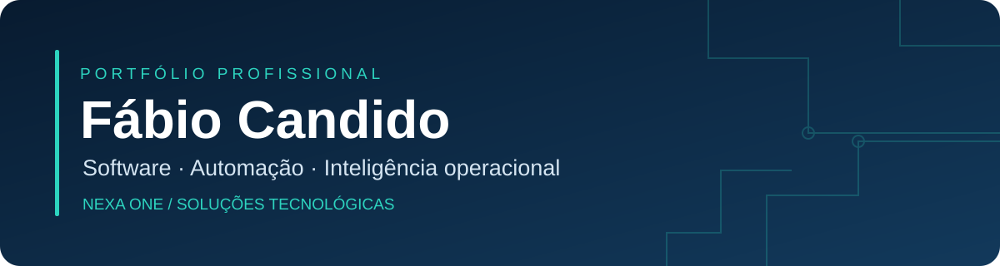
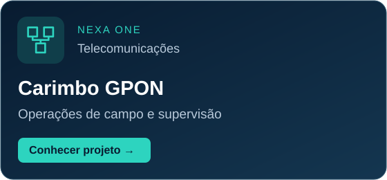
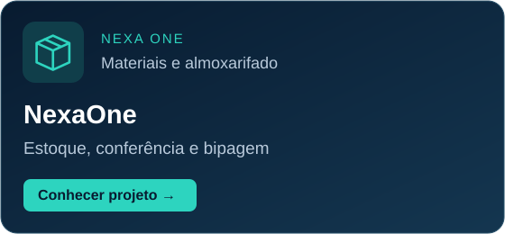
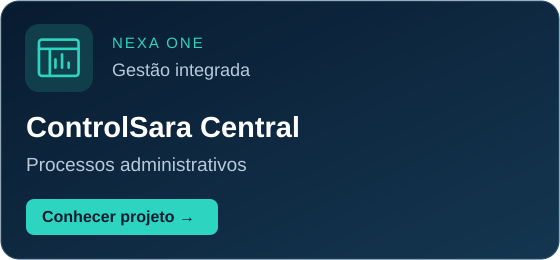
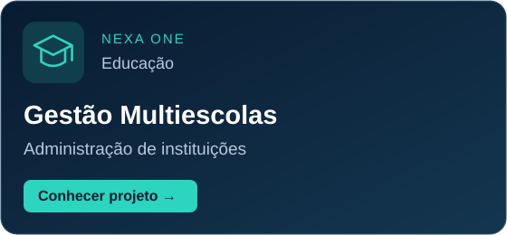
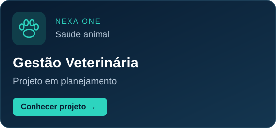
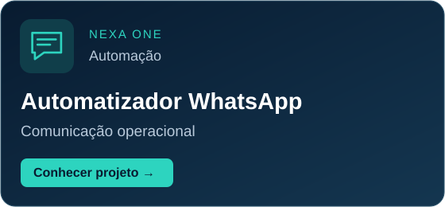

# Desenvolvimento de software e soluções empresariais

Transformo necessidades operacionais em soluções digitais, integrando aplicativos, plataformas web, bancos de dados e automação de processos.

**Gestão de TI • Desenvolvimento de software • Integração de sistemas • Inteligência operacional**

## Projetos em destaque

<table>
<tr>
<td width="50%"></td>
<td width="50%"></td>
</tr>
<tr>
<td width="50%"></td>
<td width="50%"></td>
</tr>
<tr>
<td width="50%"></td>
<td width="50%"></td>
</tr>
</table>

## Tecnologias

### Áreas de atuação

- Aplicativos Android e plataformas web
- APIs e integração de sistemas
- Infraestrutura em nuvem: Workers, D1 e R2
- Automação de processos e segurança de acesso
- Gestão operacional e digitalização de rotinas empresariais

## Sobre este portfólio

Documentação demonstrativa de projetos e iniciativas de desenvolvimento. Não são publicados códigos-fonte proprietários, credenciais, dados operacionais ou informações confidenciais. A apresentação não constitui declaração de titularidade exclusiva sobre soluções desenvolvidas em contexto empresarial.

## Conexões profissionais

[GitHub — Fabio1978Candido](https://github.com/Fabio1978Candido) · [Nexa One](portfolio/nexaone.md)
