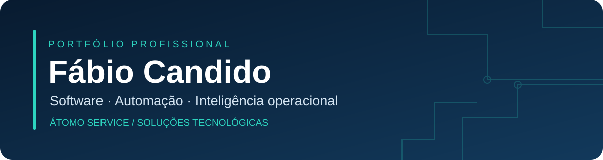

# Desenvolvimento de software e soluções empresariais

Transformo necessidades operacionais em soluções digitais, integrando aplicativos, plataformas web, bancos de dados e automação de processos.

**Gestão de TI • Desenvolvimento de software • Integração de sistemas • Inteligência operacional**

## Projetos em destaque

| Projeto | Especialidade | Apresentação |
|:---|:---|:---|
| **Carimbo GPON** | Operações de telecomunicações e serviços de campo | [Explorar →](portfolio/carimbo-gpon.md) |
| **NexaOne** | Materiais, estoque e almoxarifado | [Explorar →](portfolio/nexaone.md) |
| **ControlSara Central** | Gestão administrativa integrada | [Explorar →](portfolio/controlsara.md) |
| **Gestão Multiescolas** | Administração educacional | [Explorar →](portfolio/multiescolas.md) |
| **Gestão Veterinária** | Gestão clínica — projeto em planejamento | [Explorar →](portfolio/veterinaria.md) |
| **Automatizador WhatsApp** | Comunicação e automação operacional | [Explorar →](portfolio/automacao.md) |

## Tecnologias

### Áreas de atuação

- Aplicativos Android e plataformas web
- APIs e integração de sistemas
- Infraestrutura em nuvem: Workers, D1 e R2
- Automação de processos e segurança de acesso
- Gestão operacional e digitalização de rotinas empresariais

## Sobre este portfólio

Documentação demonstrativa de projetos e iniciativas de desenvolvimento. Não são publicados códigos-fonte proprietários, credenciais, dados operacionais ou informações confidenciais. A apresentação não constitui declaração de titularidade exclusiva sobre soluções desenvolvidas em contexto empresarial.

## Conexões profissionais

[GitHub — Fabio1978Candido](https://github.com/Fabio1978Candido) · [Nexa One](portfolio/nexaone.md)
