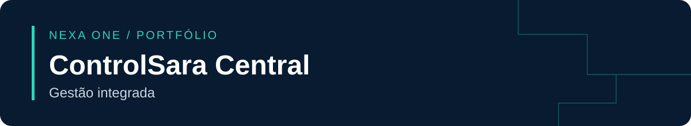

# ControlSara Central

**Área:** Gestão integrada

## Objetivo

Centralizar rotinas administrativas e integrar processos de materiais.

## Escopo funcional

- Acompanhamento de solicitações
- Conferência de materiais
- Histórico de movimentações
- Integração de processos administrativos

## Benefícios esperados

- Melhor organização das informações e dos processos.
- Redução de atividades manuais e maior rastreabilidade, conforme o escopo do projeto.

## Situação do projeto

Projeto de gestão integrada.

## Demonstrações

Capturas de tela e vídeos serão incluídos somente após autorização e revisão de confidencialidade. Não são apresentados resultados quantitativos sem validação.

## Confidencialidade

Material exclusivamente demonstrativo. Não inclui código-fonte proprietário, credenciais, dados reais ou detalhes internos. A apresentação não estabelece titularidade jurídica exclusiva.

[← Voltar ao portfólio Nexa One](../README.md)
