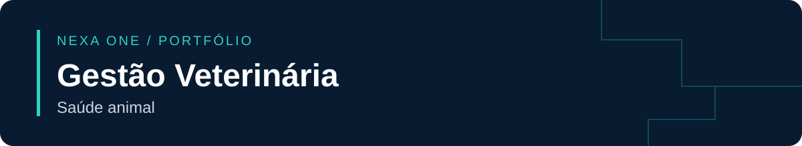

# Gestão Veterinária

**Área:** Saúde animal

## Objetivo

Propor uma plataforma para organização das rotinas clínicas e administrativas.

## Funcionalidades propostas

- Cadastro de tutores e animais
- Organização de atendimentos
- Rotinas administrativas

## Benefícios esperados

- Melhor organização das informações e dos processos.
- Redução de atividades manuais e maior rastreabilidade, conforme o escopo do projeto.

## Situação do projeto

Em planejamento. Os itens acima são propostas, não funcionalidades entregues.

## Demonstrações

Capturas de tela e vídeos serão incluídos somente após autorização e revisão de confidencialidade. Não são apresentados resultados quantitativos sem validação.

## Confidencialidade

Material exclusivamente demonstrativo. Não inclui código-fonte proprietário, credenciais, dados reais ou detalhes internos. A apresentação não estabelece titularidade jurídica exclusiva.

[← Voltar ao portfólio Nexa One](../README.md)
